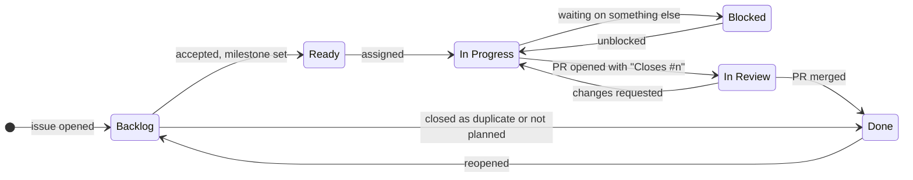

# Contributing

## Build and check

The toolchain is pinned in `rust-toolchain.toml`; the minimum supported Rust is 1.89. Before a
PR, run what CI runs. `--locked` makes a command fail instead of quietly rewriting `Cargo.lock`,
as in CI; a dependency change updates the lock file on purpose and commits it.

```sh
cargo fmt --all --check
cargo clippy --workspace --all-targets --locked -- -D warnings
cargo clippy --workspace --all-targets --all-features --locked -- -D warnings
cargo clippy -p sisa-caching-redis -p sisa-caching-hybrid --all-targets --features tls-native-tls --locked -- -D warnings
for f in "" memory redis hybrid tls-rustls tls-native-tls; do cargo check -p sisa-caching --features "$f" --locked; done
RUSTDOCFLAGS="-D warnings" cargo doc --workspace --no-deps --all-features --locked
cargo +1.89 check --workspace --all-targets --all-features --locked
cargo test --workspace --all-features --locked
cargo test -p sisa-caching-redis -p sisa-caching-hybrid --features tls-native-tls --test native_tls --locked
cargo deny check
```

## Tests

Unit tests sit at the end of the file they test, in `#[cfg(test)] mod tests`. Tests that put
several parts together, such as hybrid nodes with their workers or anything on Redis, go in the
crate's `tests/` folder. Each Redis test starts its own server in Docker through
`sisa-caching-testing`, so the suite needs Docker and nothing else. `REDIS_IMAGE` picks the
server, `redis:8-alpine` by default; CI runs Redis 7.4, Redis 8, Valkey 8, Dragonfly 2 and
Garnet 2. Each helper starts the cluster, Sentinel or TLS setup the way that
server needs it; the Sentinel tests skip themselves on Garnet. The Cluster and Sentinel tests reach their servers on the container's own IP
address, so they need Docker on a Linux host, as in CI; Docker Desktop can't route to it.

```sh
REDIS_IMAGE=valkey/valkey:8-alpine cargo test --workspace --all-features
REDIS_IMAGE=ghcr.io/dragonflydb/dragonfly:v2.0.2 cargo test --workspace --all-features
REDIS_IMAGE=ghcr.io/microsoft/garnet:2 cargo test --workspace --all-features
```

Coverage comes from [cargo-llvm-cov](https://github.com/taiki-e/cargo-llvm-cov); CI measures it on
each push to main and the README badge shows it.

```sh
cargo llvm-cov --workspace --all-features --ignore-filename-regex 'crates/testing/'
```

Write tests a reader can follow: one behavior per test, named for that behavior, as few lines as
it takes. Use `ManualClock` instead of sleeping on real time, and paused Tokio time for timers.

## Benchmarks

```sh
cargo bench -p sisa-caching-benches
cargo run -p sisa-caching-benches --bin summary
```

## Code

- Keep code minimal, readable, and working. Judge every change by that.
- Read [docs/01-architecture.md](docs/01-architecture.md) first; its rules section lists what
  reviews check.
- API docs live in Rust doc comments: short, plain, with an example where it helps. Don't link
  Markdown files from crate docs.
- The pages in `docs/` explain how the library works. Draw diagrams in Mermaid, and update the
  page a change affects in the same PR, above all the data formats in the architecture page.
- Public names are reviewed with care; rename a parameter, its getter and its field together.

## Code style

`rustfmt.toml` and `clippy.toml` settle layout and lints, and CI fails on either. What they
don't check:

- Imports come in groups separated by a blank line: `std`, other crates, then `crate` and
  `super`.
- Doc comments and comments are full sentences, wrapped at 100 columns like the code. A comment
  says why, or what a reader can't see from the code; it doesn't repeat the code.
- Names are whole words (`entry`, `deadline`), and the value type parameter is `CV` everywhere.
- Library code returns errors instead of panicking: no `unwrap` outside tests, and `expect` only
  for an invariant, with a message saying why it holds. Poisoned locks are recovered with
  `into_inner`.
- A blank line separates steps in a long function; short functions need none.
- Every public type implements `Debug`, which `missing_debug_implementations` checks. A store's
  shows its name and settings, never a cached value or a connection.

## Issues and labels

Every issue and pull request gets labels from these groups, so anyone can filter the work:

| Group | Labels | Rule |
| --- | --- | --- |
| Kind | `bug`, `enhancement`, `task`, `documentation` | Exactly one. The issue forms set it. |
| Crate | `crate: sisa-caching`, `crate: core`, `crate: memory`, `crate: redis`, `crate: hybrid`, `ci` | Every part the change touches. |
| Other | `needs info`, `breaking`, `good first issue`, `help wanted` | When they apply. |
| Automated | `dependencies`, `release` | Set by Dependabot and release-plz on their PRs. |

- `needs info`: the reporter owes details or a reproduction. Remove it once they answer.
- `breaking`: the public API or a data format changes. The PR says how to migrate.
- Close a duplicate as "duplicate" with a link, and a declined request as "not planned" with the
  reason. Answer a question in its issue, then close it.

Work moves across the `sisa-caching` project board:



Only the maintainer moves an issue to Ready and sets its milestone and Priority (P0 urgent to P3
low); milestones are release versions. Assign yourself before starting so two people don't take
the same issue. A Blocked issue says in a comment what it waits on. Start date and Target date
place an issue on the Roadmap view.

Releases are cut by hand, so a merged issue can be Done before it ships. Its milestone tells:
while the milestone is open, its release isn't out yet. The maintainer closes a milestone once
its release is published.

The labels, milestones, board and the rulesets on `main` and the `v*` tags are kept in
[.github/scripts](.github/scripts/README.md). Change them there in a PR, and a maintainer runs the
script after the merge. A run overwrites what it manages, so a change made only on GitHub doesn't
last.

## Git

- Every PR closes an issue: open one first if none exists, and say `Closes #n` in the PR. Only
  Dependabot's and release-plz's PRs come without one.
- Branch from `main` as `<type>/<issue>-<topic>`, one topic per PR. `<type>` is the
  [commit type](#commit-messages) of the change and `<issue>` the number of the issue it closes,
  such as `feat/31-memory-ttl`, `fix/42-redis-reconnect` or `ci/17-tag-ruleset`. Dependabot's and
  release-plz's branches keep their own names.
- Bring a branch up to date by rebasing onto `main`; don't merge `main` into it.
- PRs merge with the rebase method once CI is green.
- Commit messages and PR titles follow [Commit messages](#commit-messages).

### Commit messages

We use [Conventional Commits](https://www.conventionalcommits.org/en/v1.0.0/). release-plz reads
the type to pick the changelog section and the version bump.

```text
fix(redis): keep the TTL when get_or_set refreshes an entry

What was wrong and why this fixes it, wrapped at 72 columns.
```

- The subject is `type(scope): summary`, at most 72 characters, with no period at the end.
  Write the summary in the imperative: "add", "fix", "keep".
- The scope is optional. Use it when the change sits in one crate: `core`, `memory`, `redis`,
  `hybrid` or `facade`, or `deps` for a dependency bump.
- Add `!` after the type or scope for a breaking change (`feat(core)!: ...`), and say how to
  migrate in the body.
- The body says what changed and why. Put `[skip ci]` there, never in the subject.
- A PR title follows the same rule, since it names the change on the board.

| Type | For | Changelog |
| --- | --- | --- |
| `feat` | a new capability for users | Added |
| `fix` | a bug fix | Fixed |
| `perf` | a speed or memory improvement | Changed |
| `refactor` | a code change users don't see | left out |
| `docs` | docs and doc comments only | left out |
| `test` | tests only | left out |
| `build` | dependencies, Cargo files | left out |
| `ci` | workflows | left out |
| `chore` | anything else, such as releases | left out |
| `revert` | undoing an earlier commit | Fixed |

A hook checks each commit as you make it. Turn it on once per clone:

```sh
git config core.hooksPath .githooks
```

CI runs the same check on a PR's commits and title.
