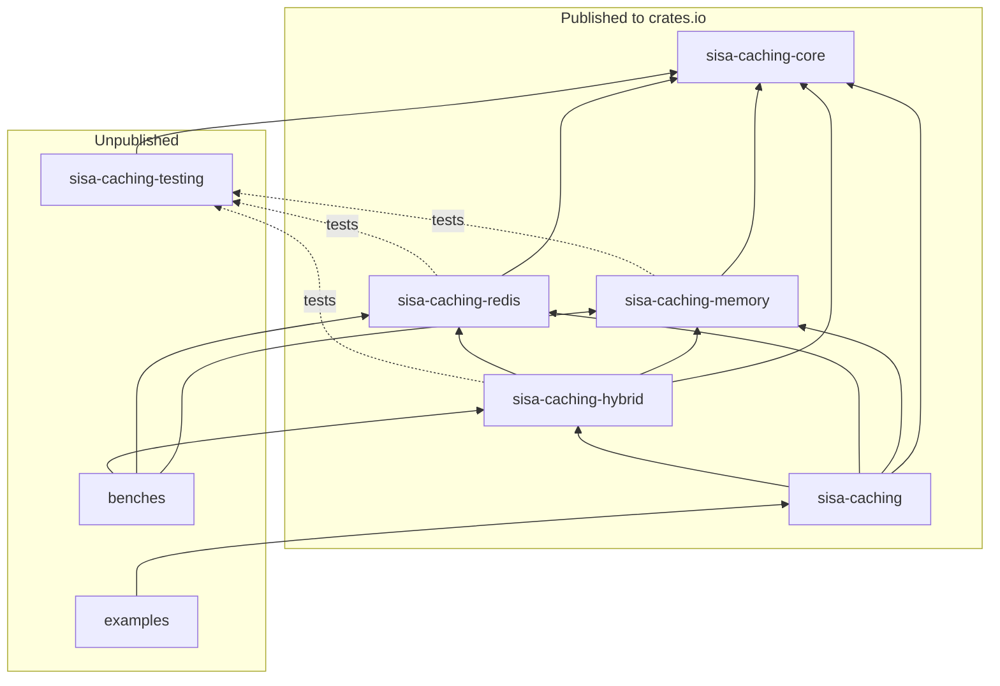

# Architecture

A map of the code for contributors. What each type does for users is in its Rust docs; this page
explains how the parts fit, what they promise, and which rules hold them together.
[Flows](02-flows.md) draws each step described here.

## Goals

- **One API over three stores.** Application code calls `get`, `set` and `get_or_set` on a
  `CacheStore` and doesn't change when the store does.
- **The value type is chosen per call.** One store holds users, counts and lists side by side;
  `get::<User>` names the type it expects.
- **A shared, documented format.** Services in other languages can read and write the same Redis
  keys and invalidation messages.
- **A local layer with a known staleness bound.** The hybrid store serves reads from memory, and a
  node never serves a value it was told is invalid. When a message is lost, the writer's next
  heartbeat shows it and the node clears its local layer; the memory store's `max_ttl_secs` caps
  every copy all the same.
- **Small and explicit.** Building a store is all the setup: it runs its own worker. No hidden
  dependencies, and each store has one read path and one write path.

## Crates



An arrow points from a crate to one it depends on; a dotted arrow is a dev-dependency.
`sisa-caching` depends on every part, each behind its feature, and re-exports what applications
use. `examples` use it; `benches` use every store crate directly.

| Crate | Published | Main types | What it holds |
| --- | --- | --- | --- |
| `sisa-caching` | Yes | Everything below that an application uses | Re-exports only; features `memory`, `redis`, `hybrid` pick the stores, `tls-rustls` or `tls-native-tls` adds TLS (none by default) |
| `sisa-caching-core` | Yes | `CacheStore`, `KeyPrefix`, `CacheKey`, `CacheEntry`, `CacheOptions`, `CacheSettings` | The store trait, keys, entries, settings with their 365-day limit, the per-key `Locker` behind `get_or_set`, the `Clock`, the OpenTelemetry instruments in `metrics`, and the `Worker` that runs a store's background task |
| `sisa-caching-memory` | Yes | `InMemoryCacheStore` | Sharded maps of `Arc<dyn Any>` values with LRU trimming, and the worker that purges them |
| `sisa-caching-redis` | Yes | `RedisCacheStore` | One hash per key with JSON in `value`, over any `RedisConnection`: one server, a cluster or Sentinel |
| `sisa-caching-hybrid` | Yes | `HybridCacheStore`, `RedisBackplane` | A local memory store in front of a distributed `CacheStore`, kept coherent over Redis pub/sub (`RedisBackplane`) by a worker each store runs |
| `sisa-caching-testing` | No | `ManualClock`, `Redis`, `eventually` | A test clock, a Redis container per test (one server, a cluster, Sentinel or TLS), and a wait-until helper |
| `examples` | No | | Axum services over a shared users API: one per store, and one that picks its store from configuration |
| `benches` | No | | Criterion benchmarks for every store and the `summary` table printer |

`memory` and `redis` don't depend on OpenTelemetry directly; they count through `core::metrics`.

## The store contract

`CacheStore` in core is the whole interface:

| Method | What it does |
| --- | --- |
| `get_entry::<CV>(key)` | The one read path: the live entry with its creation time and TTL, or `None` |
| `set_entry(key, entry)` | The one write path: stores the entry until its deadline |
| `get`, `set` | Wrappers over the two paths that take and return the bare value |
| `get_or_set(key, loader)` | Reads, else loads once per key per process and stores the result |
| `remove`, `remove_prefix`, `clear` | Drop one key, every key under a prefix, or the whole store |

Rules every store follows:
- **Entries keep their deadline.** An entry carries the time it was written and its TTL. Stores
  never reset them, so copying an entry from Redis into memory, or writing one from another
  language, keeps the original expiry.
- **Keys.** A store has a name, such as `app`, checked when the store is built, and keys,
  which are any `&str`, such as `user:42`. The stored key is `app::user:42`. A store name never
  holds `::`, so the first `::` always ends it and stores `a` and `a:b` never share keys,
  whatever the key holds. `remove_prefix("user")` removes whole levels: `user:42`, not
  `users:42`, nor the key `user` itself. `CacheKey` is an optional, checked way to build a key.
- **Values.** Any `CV: Serialize + DeserializeOwned + Clone + Send + Sync + 'static`. Memory keeps
  the Rust value itself as `Arc<dyn Any>`, so reading it as another type is
  `CacheError::TypeMismatch`. Redis keeps JSON, so reading it as another type is a decode error.
- **TTLs.** Settings and per-call TTLs are capped at 365 days, checked once in each settings
  type's `validate` and in `CacheOptions::validate`.
- **`set` and `get_or_set`** are default methods of `CacheStore`, written once on top of each
  store's `get_entry` and `set_entry`. `get_or_set` takes a per-key lock, waits up to
  `lock_timeout_ms`, reads again under the lock, and only then loads. Past
  `refresh_threshold`, the first caller to take the lock reloads while the others get the cached
  value.

## Inside each store

### Memory

`InMemoryCacheStore` keeps `shards` hash maps (1 by default), each behind its own lock. An entry
stays for its remaining TTL, capped at `max_ttl_secs`. Past `max_entries`, a write starts a trim
that drops expired entries, then the least recently used ones down to 90% of the limit, so the
next writes don't trim again. Values are freed after the lock is released. Expired entries read as
misses and go when they are overwritten, trimmed, or purged. The store purges every
`purge_interval_secs` on its worker. Inside a tokio runtime the trims, the purges and the freeing
of what `clear` took run on the blocking pool, so a store of a million entries holds up no async
thread; `remove_prefix` and `purge` called by the application run on the caller's thread.

### Redis

`RedisCacheStore` keeps one hash per key, with `value` (JSON), `created_at` and `ttl_ms`. A write is
one transaction: `DEL`, `HSET`, `PEXPIRE` with the remaining TTL. A read is `HMGET` and `PTTL` in
one transaction, so the expiry comes from Redis, not from the writer's clock. It works over any
`RedisConnection`: a `ConnectionManager` (the usual one, which reconnects on its own; with
`connection_config()` a call while the server is down fails at once instead of waiting about 9 s), a
`MultiplexedConnection`, a `ClusterConnection` or a `SentinelConnection`. `remove_prefix` and
`clear` walk keys with `SCAN` and `UNLINK`, on each primary of a cluster. `SCAN MATCH` visits every
key in the database, not only the store's, so their cost grows with the whole database: on one with
10 million keys, a `remove_prefix` takes about 10,000 round trips at the default `scan_batch_size`
of 1,000. Give caches a database or an instance of their own, or raise `scan_batch_size`.

### Hybrid

`HybridCacheStore` puts a memory store (the local layer) in front of any `CacheStore` (usually
Redis), and uses `RedisBackplane` (Redis pub/sub) to tell other nodes about writes.
- **Read:** local layer first; on a miss, the distributed store, then copy the entry into the
  local layer.
- **Write:** evict locally, write the distributed store, evict again, publish an
  invalidation (a key, a prefix, or clear). The steps after the first eviction run in their own
  task, so a cancelled caller can't stop the publish. The call returns after the second eviction,
  or for a prefix once its keys read as misses, as its walk runs on the blocking pool; the
  publish and its retries finish in the background.
- **Generations:** each key hashes to one of 64 counters. An invalidation bumps the counter before
  it evicts, and a read only copies into the local layer if the counter didn't move. An
  invalidation waits for a copy in progress, so a slow read can't put back a value that was just
  invalidated, not even for a moment.
- **Backplane worker:** applies other nodes' invalidations. Local reads are on only while it is
  subscribed; every subscribe and every loss clears the local layer.
- Invalidations touch only local layers and generations, never Redis. Each message carries the
  writer's trace context.
- **Channel:** each store publishes and subscribes on its own pub/sub channel,
  `<store>:backplane`, so a node gets only the messages of the stores it runs. On a cluster,
  sharded pub/sub puts each store's channel on the node that owns its slot.

#### Several hybrid stores

One store holds values of every type, so an application usually needs one, such as
`catalog_hybrid_cache` holding categories, groups and products under their own key prefixes. Run
a second store, such as `user_hybrid_cache`, when a set of data needs other settings: another
TTL, another `max_entries`, or another `max_ttl_secs` for its local copies.

Each store has its own local layer, generations, worker, subscription connection and channel, so
the stores don't affect each other: a burst of writes to one never fills another's subscription
queue, and a lost subscription clears only its own store's local layer. Each store also sends its
own heartbeats, one per `heartbeat_interval_ms` per node. Create each store once at startup and
share it through clones; building one per request would open a subscription each time.

Store names must differ, since the name prefixes every key and names the channel. Redis delivers
a message to subscribers on every database, so two deployments that share a server, such as
production and staging, need different store names even on separate databases: `prod:catalog`
and `staging:catalog`.

## Data formats

Services in other languages can share a Redis store and its invalidations by following these two
formats. Both change only with a version bump that the changelog calls out.

The memory store has no format of its own: its values stay Rust values inside the process and
never leave it as bytes. Every store shares the same entry model, a value with the time it was
written and an optional TTL.

### Keys

A stored key is `{store}::{key}`, such as `app::user:42`.

| Part | Rule | Example |
| --- | --- | --- |
| Store name | One or more levels joined by `:`, none empty | `app`, `tenant:eu` |
| Key | Any string; `:` separates its levels | `user:v1:42`, `42`, `user:eu:ada@example.com` |
| Prefix | One or more levels joined by `:`, none empty; matches the keys below it, by whole levels: `user` matches `user:42`, not `users:42` or `user` | `user`, `user:v1`, `user:eu` |

The store name never holds `::`, so the first `::` always ends it, and stores `a` and `a:b` never
share keys.

Put the version of what a key holds right after its name, such as `user:v1:42` or `users:count:v1`,
so it works the same for structs, scalars and lists. Bump it when a field is renamed or changes
type, or a value keeps its shape but changes meaning; adding or removing a field needs no bump.
Bump every key that holds the type, such as a list of users along with each user. Once no old node
is left, `remove_prefix("user:v1")` drops the old entries (run earlier, old nodes write them back),
while `remove_prefix("users")` still drops every version under `users`.

> [!WARNING]
> Nothing checks for the version: a key without one works, and so does a forgotten bump. Deciding
> when to bump is the application's job.

### Redis entry

Each key is a Redis hash:

| Field | Required | Value |
| --- | --- | --- |
| `value` | Yes | The value as UTF-8 JSON, such as `{"id":42,"name":"Ada"}` |
| `created_at` | Yes | When it was written, in Unix milliseconds |
| `ttl_ms` | No | Its full TTL in milliseconds; leave it out when it never expires (Rust also leaves out a TTL over `i64::MAX / 2` ms) |

To write, replace the whole hash and set its expiry in one transaction. `PEXPIRE` takes the time
left, which is `ttl_ms` for a fresh entry:

```text
MULTI
DEL     app::user:42
HSET    app::user:42 value '{"id":42,"name":"Ada"}' created_at 1760940000000 ttl_ms 300000
PEXPIRE app::user:42 300000
EXEC
```

Leave out `ttl_ms` and `PEXPIRE` for an entry that never expires. To read, run
`HMGET app::user:42 value created_at ttl_ms` and `PTTL app::user:42` together. A missing `value`,
or a `PTTL` of `-2`, is a miss. The entry expires when `PTTL` says, so readers never compare
clocks. A `value` that isn't valid JSON for the requested type fails the read with a decode
error.

### Invalidation message

After each write, a hybrid node publishes one JSON message on its store's pub/sub channel,
`<store>:backplane`, such as `app:backplane` for a store named `app`. A writer in another language
publishes on the same channel:

| Field | Required | Value |
| --- | --- | --- |
| `v` | Yes | The format version, `1` |
| `source` | Yes | An id unique to the writing process; nodes skip their own messages |
| `store` | Yes | The store name, such as `app` |
| `seq` | No | On an invalidation, its number in the writer's sequence, from 1 up; on a heartbeat, the number up to which the writer has finished publishing |
| `kind` | Yes | `key`, `prefix`, `clear`, `heartbeat`, or `stopping` |
| `target` | For `key` and `prefix` | The key or prefix, without the store name |
| `trace` | No | Trace propagation fields, such as `traceparent` |

```json
{"v":1,"source":"node-7","store":"app","seq":41,"kind":"key","target":"user:42"}
{"v":1,"source":"node-7","store":"app","seq":42,"kind":"prefix","target":"user"}
{"v":1,"source":"node-7","store":"app","seq":43,"kind":"clear"}
{"v":1,"source":"node-7","store":"app","seq":43,"kind":"heartbeat"}
{"v":1,"source":"node-7","store":"app","seq":43,"kind":"stopping"}
```

Each store's worker publishes a heartbeat every `heartbeat_interval_ms`. A heartbeat only counts
publishes that are over, so on one channel it arrives after the invalidations it covers. A node
that received fewer of a writer's numbers than the heartbeat accounts for, or that hears no
heartbeat from a writer for `heartbeat_timeout_ms`, clears its local layer. A node tracks a
writer from the first message it gets from it. Nothing says which of the writer's earlier numbers
came before the subscribe, so the writer's first heartbeat clears the local layer unless every
number up to it arrived: after each subscribe, a node clears once more for every writer that
published before, which covers an invalidation lost in between, as during a failover.

`HybridCacheStore::shutdown` stops the store's worker and its heartbeats, waits up to two seconds
for the invalidations still being published, then publishes `stopping`: a last heartbeat, which
the other nodes check like any other and then forget the writer, instead of clearing their local
layers `heartbeat_timeout_ms` later. No heartbeat follows it.

A service in another language that writes to Redis publishes the matching message after each
write, so hybrid nodes drop their copies. It can leave out `seq` and the heartbeats, and nodes
then apply its messages without tracking them. Keep messages exact: a node that receives one it
can't read, an unknown `v` included, clears its local layer, logs a warning and counts it, and
stays subscribed.

## Guarantees and limits

| | |
| --- | --- |
| **Guaranteed** | After a write returns, this node's local copy is gone, and every node that receives the message drops its copy. |
| **Guaranteed** | A node serves a stale local copy for at most the local `max_ttl_secs` (60 seconds in `HybridCacheSettings`), even if every message is lost. With the cap set to `None`, or a local store built without those settings, the bound is the entry's own TTL. |
| **Guaranteed** | Once the worker notices the backplane is down (a failed read or ping, or its own heartbeats no longer coming back), the node reads only from the distributed store until it resubscribes. |
| **Guaranteed** | When every publish attempt of a writer fails, or a message is lost while the subscription stays up, other nodes clear their local layer at the writer's next heartbeat. |
| **Guaranteed** | If a process stops between the Redis write and the publish, other nodes clear their local layer once its heartbeats have stopped for `heartbeat_timeout_ms` (5 seconds by default). They also clear when a process stops without calling `shutdown`, so a rolling deploy that skips it clears every node's local layer once for each node it replaces. |
| **Not guaranteed** | Delivery is at most once: pub/sub drops messages to a node that is reconnecting. The clear on resubscribe covers the gap. |
| **Not guaranteed** | A lost invalidation without a `seq`, as a service in another language may send, is bounded only by `max_ttl_secs`. |
| **Not guaranteed** | An invalidation lost just before its writer stops for good is bounded only by `max_ttl_secs` on a node that subscribed less than `heartbeat_interval_ms` earlier and hasn't heard from that writer yet. |
| **Not guaranteed** | While a writer can't publish for longer than `heartbeat_timeout_ms`, other nodes clear when its heartbeats stop and again at its first heartbeat after, so a copy read in between can be stale until then. |
| **Not guaranteed** | A read that overlaps a write on another node may copy the old value; the write's invalidation then evicts it. |
| **Not guaranteed** | A write the primary acknowledged just before a failover; see [Compatibility](03-compatibility.md). |
| **Not guaranteed** | A Redis write held up on its way to the server (queued behind other commands, waiting for a reconnect, or resent after a failover) gives its entry that much longer: Redis counts down the time left from when it runs the write. |
| **Not guaranteed** | Adding or removing a field of a cached type needs nothing: `get_or_set` stores over an entry it can't read, and serde skips fields a type doesn't have (unless it sets `deny_unknown_fields`). A renamed field or a changed field type makes the old and new versions of a rolling deploy replace each other's entries, so that key loads on most calls until the old version is gone, and a value that keeps its shape but changes meaning is misread unnoticed. Bump the key's version for such a change; see [Keys](#keys). |
| **Not guaranteed** | With `lock_timeout_ms` set to `None`, a loader that hangs holds up every `get_or_set` for its key for as long. The default, 30 seconds, lets waiters load the value themselves. |

## Errors

| Store | Error type | Returned for |
| --- | --- | --- |
| all | `CacheError` | `InvalidKey`, `TypeMismatch` (memory), `InvalidSettings` (a setting out of range, such as a TTL over 365 days) |
| Redis | `RedisCacheError` | `Cache`, `Redis` (connection or command), `Json` (encode or decode) |
| Hybrid | `HybridCacheError` | `Cache`, `StoreNameMismatch` at construction, `Distributed` (the distributed store's error), `WriteStopped` (the write task panicked, or the runtime shut down before it finished) |

The error enums and `metrics::Layer` are `#[non_exhaustive]`, so a later release can add a
variant without breaking a `match`.

Some failures are logged as warnings and not returned, because the caller still gets a correct
answer:
- `get_or_set` couldn't read what the key holds (it stores over it) or couldn't store what it
  loaded, logged at the first failure of a run and counted each time;
- `get_or_set`'s lock wait timed out;
- a refresh failed;
- a hybrid publish failed after three tries;
- the backplane subscription was lost or couldn't be made;
- a backplane message couldn't be read, or an invalidation went missing, which clears the local
  layer.

A local-layer type mismatch in the hybrid store reads through to the distributed store.

## Decisions

Settled; reopen only with new evidence.

| Decision | Why |
| --- | --- |
| No byte-size cap on the memory store | `max_entries` is the one bound; the size of an arbitrary Rust value can't be measured cheaply or reliably |
| No deduplication of invalidations | The only duplicate source is a publish retry, and applying an eviction twice is harmless |
| No per-entry version in Redis | Versions from different nodes' clocks can't be compared safely; generations and eviction-on-write cover the race |
| Redis expiry is relative (`PEXPIRE`), not absolute (`PEXPIREAT`) | An absolute deadline needs the writer's clock to agree with the server's; a relative one is off only by how long the write takes to arrive |
| A hybrid write returns `Ok` when every publish fails | The data is written; peers clear their local layers at the writer's next heartbeat, and the failure is logged and counted |
| Reads stay on the Redis primary | Replica lag would let a node copy a value that was just replaced back into its local layer. Behind Sentinel, a connection keeps reading from the old primary after a failover until its next write; [Compatibility](03-compatibility.md#sentinel) says what that allows |
| Each store starts its own worker, once | A store can't run without its listener or with two, and needs no setup |
| One backplane, `RedisBackplane`, with no trait for others | Applications can't supply a transport of their own, so the message type, the subscription and what the worker expects of them stay private and can change without a breaking release |

## Rules that hold the design together

- A store starts its worker through its `Worker`, once, inside a tokio runtime: the memory store
  its purge worker on its first write, the hybrid store its backplane worker on its first call
  or in `connect`. That worker holds the store's entries or state but never its `Worker`, so the
  store's last clone dropping stops it.
- One `CacheEntry<CV>` type for every store; the value type parameter is `CV` everywhere.
- Keep a trait even with one implementation when it marks a seam: `CacheCodec` and `JsonCodec`.
- The Redis hash and the backplane message are formats other languages write, so they change only
  with a version bump.
- Durations in settings are `u64` seconds or milliseconds. A setting that can be off is an `Option`,
  off with `None`, and `validate` rejects `0` in every setting and a duration over 365 days,
  naming the field. Each store's settings and `HybridCacheSettings` have one `validate`, and
  `with_settings` and `with_worker_settings` return a `Result`; `HybridCacheStore::new` checks the
  backplane's settings.
  Settings nest (a store's shared `CacheSettings` sit under `common`, a hybrid's parts under
  `local`, `distributed`, `backplane` and `worker`), and an unknown field fails to deserialize, so a
  misspelled setting can't silently keep its default. A hybrid's `local.common` fails `validate`:
  hybrid calls read `distributed.common`.
- Info spans and warnings carry the store and the invalidation kind, never a key; only debug spans
  carry keys. Stores warn only about the errors they swallow. Their info lines say that a worker
  started or stopped, a backplane subscribed, or store calls work again, and a worker's panic logs
  an error.
