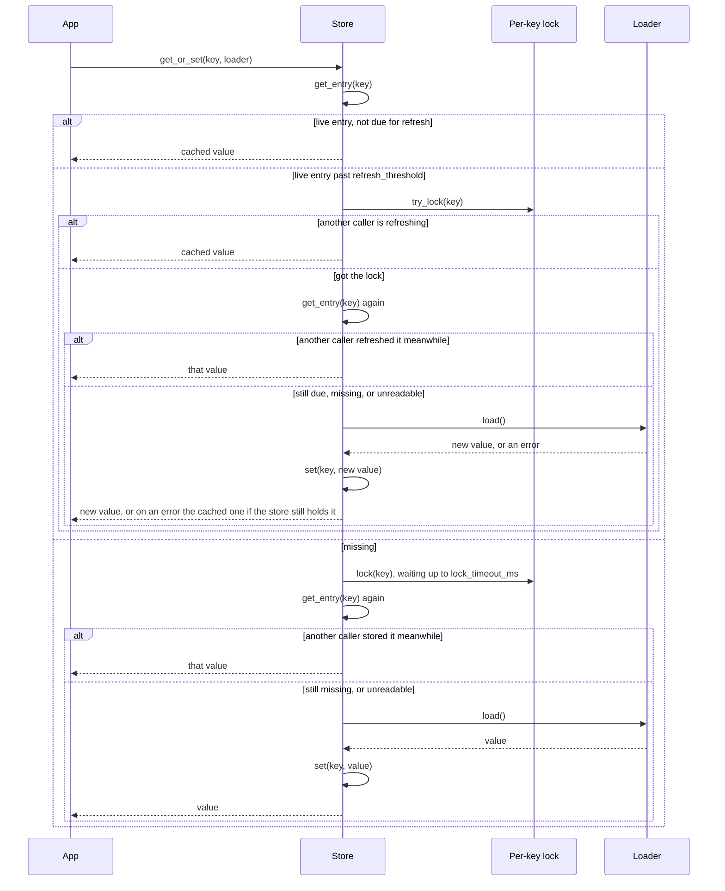
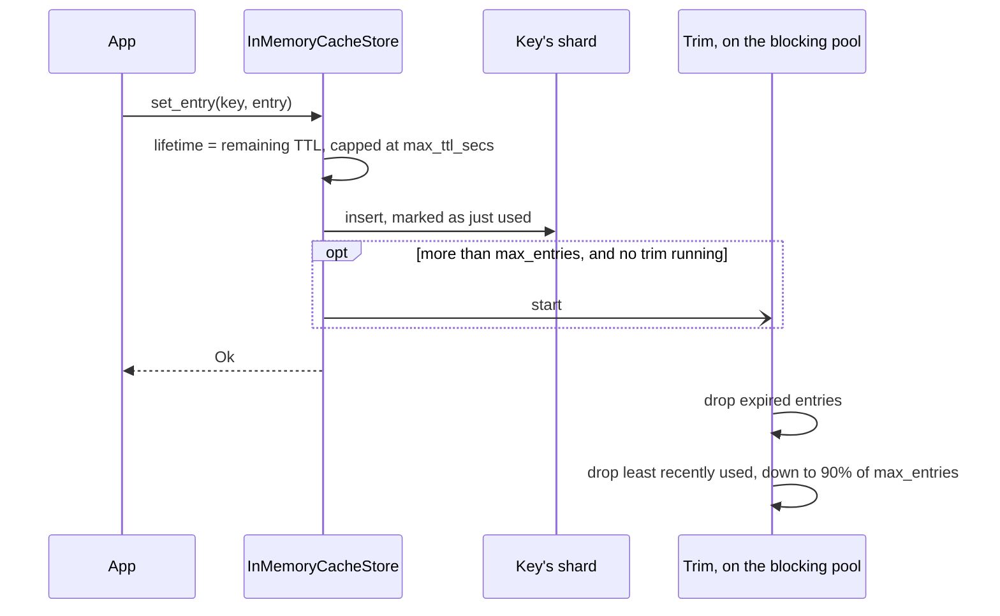
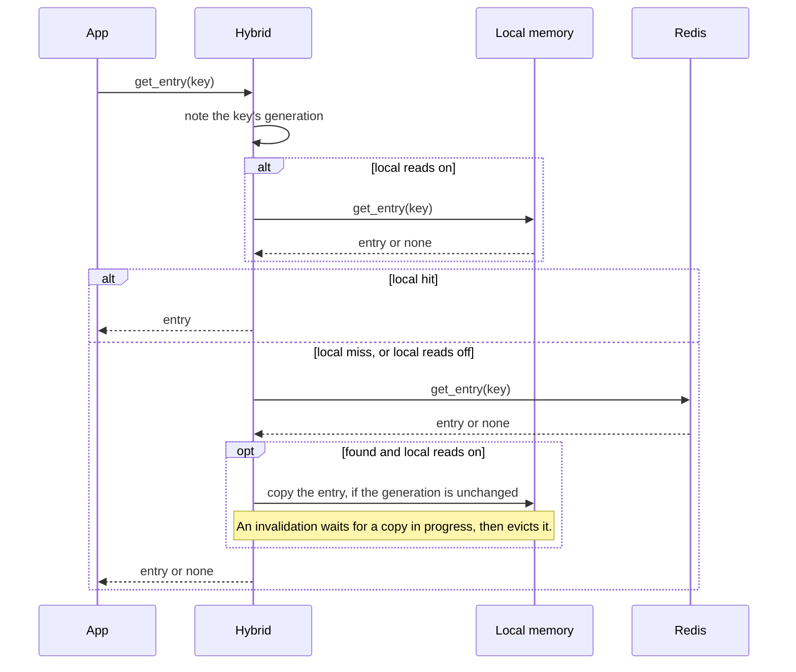
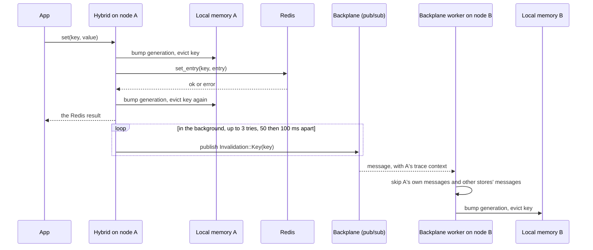
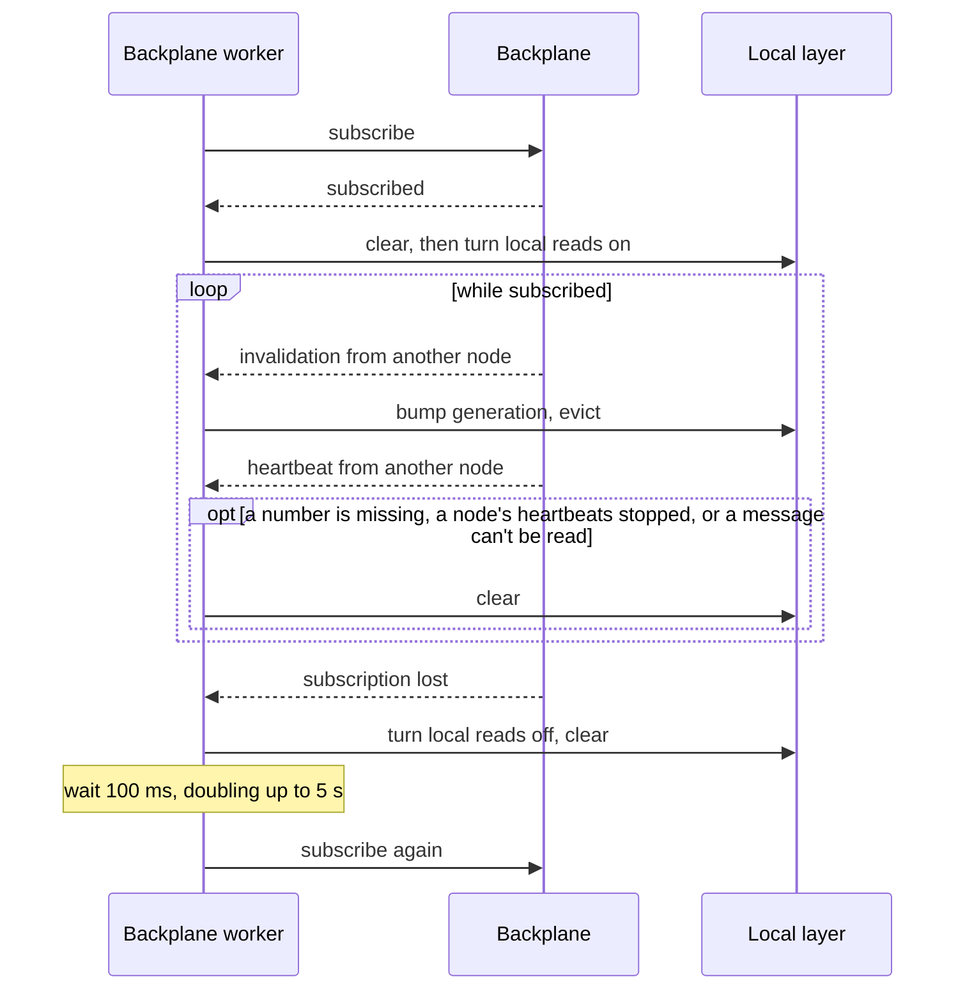
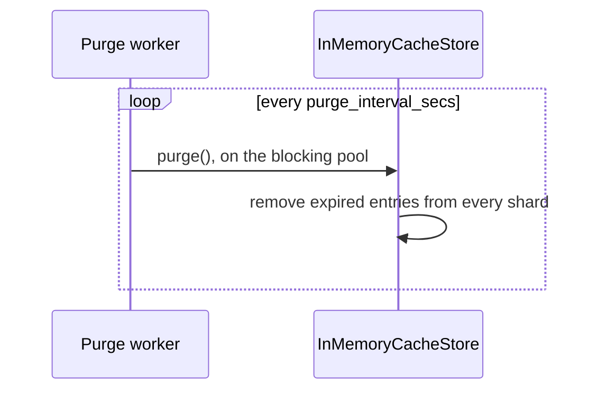
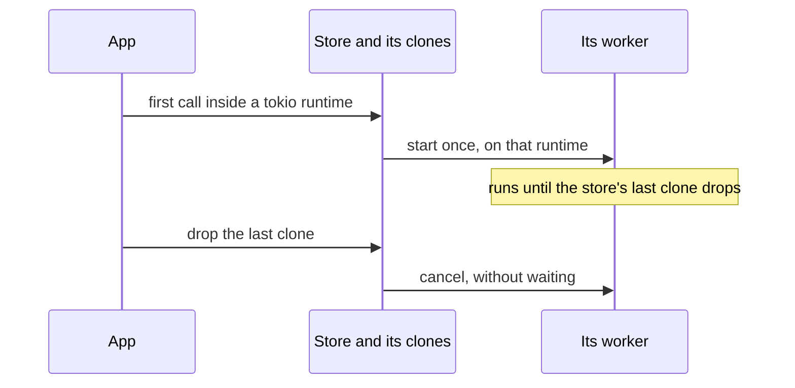

# Flows

How a call moves through the stores, step by step. [Architecture](01-architecture.md) explains
why each step is there.

## `get_or_set`, on every store

One loader runs per key per process. Other callers for the same key wait on its lock, up to
`lock_timeout_ms`, then read what it stored.



If the lock wait times out, the caller loads without the lock and logs a warning. If the second
read fails, for example because a value of another type is there, the loaded value is stored over
it.

## Memory store write



Only one trim runs at a time, and writes go on while it runs, so the store can go over
`max_entries` meanwhile. Outside a tokio runtime the write runs the trim itself. Replaced and
dropped values are freed after the shard's lock is released, so a large value never holds up
other callers.

A read looks the key up in its shard and marks it as used. An expired entry, including one
written with no lifetime left, reads as a miss and stays until a purge, a trim or a write to its
key.

## Redis store write and read

Each key is a hash: `value` (JSON), `created_at` and optionally `ttl_ms`. Another language
writing the same keys follows these two steps; [Data formats](01-architecture.md#data-formats)
has the full contract.

```mermaid
sequenceDiagram
    participant App
    participant Store as RedisCacheStore
    participant Redis

    App->>Store: set_entry(key, entry)
    Store->>Store: encode the value as JSON
    Store->>Redis: MULTI, DEL key, HSET key value created_at ttl_ms, PEXPIRE key remaining_ms, EXEC
    Note over Store,Redis: An already expired entry only sends DEL; one that never expires gets no PEXPIRE.
    Redis-->>Store: OK
    Store-->>App: Ok

    App->>Store: get_entry(key)
    Store->>Redis: MULTI, HMGET key value created_at ttl_ms, PTTL key, EXEC
    Redis-->>Store: fields and the remaining TTL
    alt no value, or the key is gone
        Store-->>App: None
    else
        Store->>Store: decode JSON into the requested type
        Store-->>App: entry, expiring after PTTL
    end
```

A value that doesn't decode into the requested type returns an error rather than `None`, so `get`
shows a type mix-up; the misses counter still counts it. `get_or_set` loads and stores over it.

## Hybrid read



## Hybrid write and invalidation

`set`, `set_entry`, `remove`, `remove_prefix` and `clear` all take this path. The steps after
the first eviction run in their own task, so they finish even if the caller is cancelled. The call
returns once Redis has answered and the key is evicted again, or for a prefix once its keys read as
misses while the blocking pool walks them; the publish and its retries carry on in the background,
so a backplane that can't be reached doesn't slow writes down.



If every publish try fails, the write has already returned the Redis result, and a warning is
logged. Node A's next heartbeat shows node B the missing sequence number, and node B clears its
local layer.

## Backplane worker



The local layer is cleared on every subscribe, because copies made before it may have missed
invalidations. While reads are off, every read goes to Redis. The wait only starts over from
100 ms after a subscription that stayed up for at least 5 s, so a connection that keeps dropping
can't clear the local layer in a tight loop. If subscribing fails, the worker waits the same way
and tries again. A Redis subscription holds up to 8,192 messages the worker hasn't read yet; a
worker that falls further behind loses its subscription the same way, instead of the messages
queueing without a bound.

The worker publishes its own heartbeat every `heartbeat_interval_ms`, subscribed or not. When its
own heartbeats stop coming back for `heartbeat_timeout_ms`, the subscription has stopped
delivering, so the worker treats it as lost.

A prefix invalidation walks every local entry, so the worker bumps the generations, leaves the walk
to the blocking pool and goes on receiving; a writer's own `remove_prefix` hands its walk over the
same way. The prefix's keys read as local misses until the walk is done. With 16 walks already
queued, another prefix clears the local layer instead. A clear empties the local layer at once and
frees what it held there too.

## Purge worker



Without a purge interval the store starts no purge worker. An expired entry then stays in memory
until its key is written again, `max_entries` trims it, or the application calls `purge`; with
none of those, the entries of keys that are never written again stay for good.

## How a store runs its worker



The memory store starts its purge worker on its first write, since entries only come in there.
The hybrid store starts its backplane worker on its first read or write, or in `connect`, so a
node that only writes runs one too. A worker holds the store's entries or state but not the
store's `Worker`, so it never keeps itself running. A call outside a tokio runtime starts
nothing, and the next one inside a runtime does. When the backplane worker stops for any reason,
such as a panic, its hybrid store turns local reads off and reads Redis from then on.
