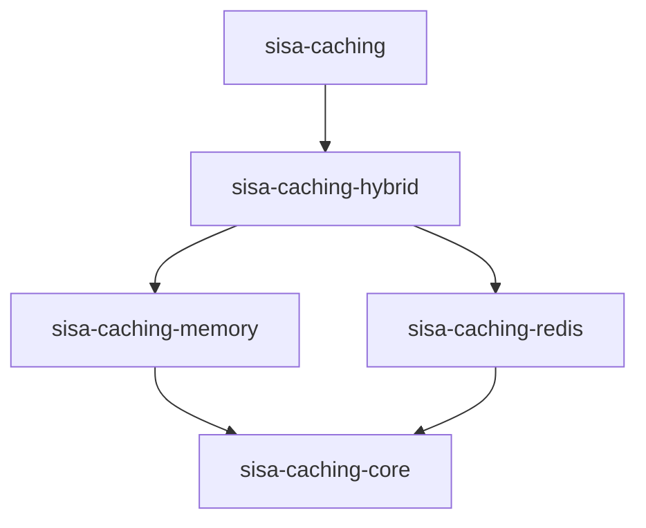

# Architecture

A map of the code for contributors: the goals, the crate map, what the library promises, what each
failure does, and the rules that hold the design together. What each crate does is in its
[spec](specs/README.md); the keys, the Redis entry and the invalidation message are in
[Formats](formats.md); [Flows](flows.md) draws each step; and the [decisions](adr/README.md) say
why it is this way. The words used everywhere are in the
[docs index](README.md#words-used-everywhere). What each type does for users is in its Rust docs.

## Goals

- **One API over three stores.** Application code calls `get`, `set` and `get_or_set` on a
  `CacheStore` and doesn't change when the store does.
- **The value type is chosen per call.** One store holds users, counts and lists side by side;
  `get::<User>` names the type it expects.
- **A shared, documented format.** Services in other languages can read and write the same Redis
  keys and invalidation messages.
- **A local layer with a known staleness bound.** The hybrid store serves reads from memory, and a
  node never serves a value it was told is invalid. When a message is lost, the writer's next
  heartbeat shows it and the node clears its local layer; every copy expires after the local
  `ttl_secs` all the same.
- **Small and explicit.** Building a store is all the setup: it runs its own worker. No hidden
  dependencies, and each store has one read path and one write path.

## Crates

The published crates, each built on the ones below it:

`sisa-caching` re-exports what applications use from every store crate, each behind its
feature, so with only `memory` or `redis` on it uses that store crate without the hybrid one.
Three more stay unpublished: `sisa-caching-testing`, built on core, which only the store crates'
tests use; `examples`, which use `sisa-caching`; and `benches`, which use the store crates
directly.

| Crate and its spec | Published | Main types | What it holds |
| --- | --- | --- | --- |
| [`sisa-caching`](specs/facade.md) | Yes | Everything below that an application uses | Re-exports only; features `memory`, `redis`, `hybrid` pick the stores, `tls-rustls` or `tls-native-tls` adds TLS (none by default) |
| [`sisa-caching-core`](specs/core.md) | Yes | `CacheStore`, `KeyPrefix`, `CacheKey`, `CacheEntry`, `CacheOptions`, `CacheSettings` | The store trait, keys, entries, settings with their 365-day limit, the per-key `Locker` behind `get_or_set`, the `Clock`, the OpenTelemetry instruments in `metrics`, and the `Worker` that runs a store's background task |
| [`sisa-caching-memory`](specs/memory.md) | Yes | `InMemoryCacheStore` | Sharded maps of `Arc<dyn Any>` values with LRU trimming, and the worker that purges them |
| [`sisa-caching-redis`](specs/redis.md) | Yes | `RedisCacheStore` | One hash per key with JSON in `value`, over any `RedisConnection`: one server, a cluster or Sentinel |
| [`sisa-caching-hybrid`](specs/hybrid.md) | Yes | `HybridCacheStore`, `RedisBackplane` | A local memory store in front of a distributed `CacheStore`, kept coherent over Redis pub/sub (`RedisBackplane`) by a worker each store runs |
| [`sisa-caching-testing`](specs/testing.md) | No | `ManualClock`, `Redis`, `eventually` | A test clock, a Redis container per test (one server, a cluster, Sentinel or TLS), and a wait-until helper |
| `examples` | No | | An Axum service over a shared users API that picks its store from configuration |
| `benches` | No | | Criterion benchmarks for every store and the `summary` table printer |

`memory` and `redis` don't depend on OpenTelemetry directly; they count through `core::metrics`.

Every store implements one trait, `CacheStore`, so application code doesn't change when the store
does. [The store contract](specs/core.md#the-store-contract) lists its methods and the rules every
store follows, and each store's spec says how it works inside.

## Guarantees and limits

| | |
| --- | --- |
| **Guaranteed** | After a write returns, this node's local copy is gone, and every node that receives the message drops its copy. |
| **Guaranteed** | A node serves a stale local copy for at most the local `ttl_secs` (60 seconds by default), even if every message is lost. It can't be turned off, so this holds for an entry with no TTL too. |
| **Guaranteed** | Once the worker notices the backplane is down (a closed subscription, or its own heartbeats no longer coming back), the node reads only from the distributed store until it resubscribes. |
| **Guaranteed** | When every publish attempt of a writer fails, or a message is lost while the subscription stays up, other nodes clear their local layer at the writer's first heartbeat after that write, and every write the writer started before it, has finished. A heartbeat vouches only for a run of finished writes, so a slow earlier write holds the clear back until it is done. |
| **Guaranteed** | If a process stops between the Redis write and the publish, other nodes clear their local layer at its `stopping` message, or once its heartbeats have stopped for `heartbeat_timeout_ms` (5 seconds by default) when it sent none. They also clear when a process stops without calling `shutdown`, so a rolling deploy that skips it clears every node's local layer once for each node it replaces. |
| **Not guaranteed** | Delivery is at most once: pub/sub drops messages to a node that is reconnecting. The clear on resubscribe covers the gap. |
| **Not guaranteed** | A lost invalidation without a `seq`, as a service in another language may send, is bounded only by the local `ttl_secs`. |
| **Not guaranteed** | An invalidation lost just before its writer stops for good is bounded only by the local `ttl_secs` on a node that subscribed less than `heartbeat_interval_ms` earlier and hasn't heard from that writer yet. |
| **Not guaranteed** | While a writer can't publish for longer than `heartbeat_timeout_ms`, other nodes clear when its heartbeats stop and again at its first heartbeat after, so a copy read in between can be stale until then. |
| **Not guaranteed** | A read that overlaps a write on another node may copy the old value; the write's invalidation then evicts it. |
| **Not guaranteed** | A read returns the entry as it was when the store looked the key up. A value whose `Clone` takes longer than the entry has left comes back already expired, as a Redis read can expire on its way back. |
| **Not guaranteed** | A write the primary acknowledged just before a failover; see [Compatibility](compatibility.md). |
| **Not guaranteed** | A Redis write held up on its way to the server (queued behind other commands, waiting for a reconnect, or resent after a failover) gives its entry that much longer: Redis counts down the time left from when it runs the write. |
| **Not guaranteed** | Adding or removing a field of a cached type needs nothing: `get_or_set` stores over an entry it can't read, and serde skips fields a type doesn't have (unless it sets `deny_unknown_fields`). A renamed field or a changed field type makes the old and new versions of a rolling deploy replace each other's entries, so that key loads on most calls until the old version is gone, and a value that keeps its shape but changes meaning is misread unnoticed. Bump the key's version for such a change; see [Keys](formats.md#keys). |
| **Not guaranteed** | With `lock_timeout_ms` set to `None`, a loader that hangs holds up every `get_or_set` for its key for as long. The default, 30 seconds, lets waiters load the value themselves. |

## Failures

What each failure does to the calls, how long a read can stay stale, and where it shows. The
times are the defaults: heartbeats every 1 s (`heartbeat_interval_ms`), a node counted gone after
5 s without one (`heartbeat_timeout_ms`), which also bounds subscribing, and a 60 s TTL on
local copies (`local.ttl_secs`), which bounds every row of the hybrid store whatever else goes
wrong. The memory store has no outside failures: it fails only on an invalid key or setting, and
on a read as another type.

| Failure | Store | What the calls do | Stale reads | Where it shows |
| --- | --- | --- | --- | --- |
| Server down or unreachable | Redis | Fail at once with `RedisCacheError::Redis` (with `connection_config()`); the next call connects again. A primary behind Sentinel that stops answering fails each call after the 500 ms reply timeout, and a call it refuses waits for one Sentinel lookup that every failing caller shares. `get_or_set` loads on every call and returns the value without storing it; once a write has failed, callers of one key load side by side, not one at a time | None | The error on each direct call and its span; `errors` counts the failures inside `get_or_set`, which warns once per outage and logs an info line once a call works |
| Server down or unreachable | Hybrid | Local hits go on until the worker notices, within 6 s; then every call goes to the server and fails as above, with `HybridCacheError::Distributed`. A write evicts the local copy either way | None: no node can write either | As above, plus `backplane.connected` at 0, then `local.clears` with `resubscribed` when it is back |
| Server slow | Redis, hybrid | A command without a reply after 500 ms fails as above, though the server may still apply it. The first `get_or_set` that loads calls the server three times, so a server that answers none holds it for 1.5 s on top of its loader. Once its write has failed, callers stop taking turns at the key's lock and call the server twice: 1 s on top of the loader, or up to 2 s and the first caller's load for those that were waiting behind it. A cluster connection retries a failed command first, up to 16 times, and has no reply timeout unless its client sets one, so a node that doesn't answer holds a command for good. [Timeouts](compatibility.md#timeouts) says how to set them | Redis: none. Hybrid: a write that lands after its invalidation can leave a copy another node read in between, for up to 60 s | As above |
| One node cut off from the server while others write | Hybrid | The node serves its local copies until the worker notices its own heartbeats stop arriving (5 to 6 s). Then it reads through, and clears once it resubscribes | 6 s | `backplane.connected` at 0 on that node, `local.clears` with `resubscribed` |
| Subscription lost, server up | Hybrid | Local reads go off and calls read from the server until the worker resubscribes and clears the local layer | None | `backplane.connected` at 0, `local.clears` with `resubscribed` |
| Every publish of a write fails | Hybrid | The write returns `Ok`. Other nodes see the missing number at the writer's first heartbeat after that write, and every write it started earlier, has finished, and clear their local layers | About 1 s. Behind an earlier write still running, up to about 3 s on one server: its 500 ms reply timeout and three publish tries, then the heartbeat. A `remove_prefix` or `clear` holds it for its whole walk | `publish.failures` on the writer, `local.clears` with `gap` on the others |
| A writer can't publish for over 5 s | Hybrid | Other nodes clear when its heartbeats stop, and again at its first heartbeat after | Up to the writer's first heartbeat after | `local.clears` with `peer_lost`, then `gap` |
| A numbered message lost, subscription up | Hybrid | Nodes clear at the writer's first heartbeat after that write, and every write it started earlier, has finished | About 1 s; longer behind an earlier write, as above | `local.clears` with `gap` |
| A writer stops between the server write and the publish, or without `shutdown` | Hybrid | Other nodes clear when its heartbeats have stopped for 5 s, or at its `stopping` message when `shutdown` gave up waiting for the write | About 6 s, or 2 s after `shutdown` | `local.clears` with `peer_lost`, or `gap` at a stop |
| A write fails or panics at the server, or its caller gives up | Hybrid | The local copy is evicted and the invalidation published anyway, since the server may have applied the write. A write with invalid options fails before it starts and changes nothing. A panic returns `HybridCacheError::WriteStopped` | None | The returned error |
| Failover with async replication | Redis, hybrid | A write acknowledged just before it can be lost, and the new primary serves the older value until it expires. Behind Sentinel, hybrid nodes resubscribe on the new primary and clear | Redis: the entry's TTL. Hybrid: 60 s | `local.clears` with `resubscribed` |
| A message nodes can't read, or an unknown `v` | Hybrid | Every node clears its local layer, warns, and stays subscribed | None | `backplane.unreadable`, `local.clears` with `unreadable` |
| A lost message from a writer that sends no `seq` | Hybrid | Nothing notices | 60 s | Nothing |
| A stored value that doesn't decode, or another type | All | `get` returns `RedisCacheError::Json` (in `HybridCacheError::Distributed` on a hybrid) or `CacheError::TypeMismatch`; `get_or_set` loads and stores over it when it can. A hybrid local copy of another type reads through | None | The returned error; `errors` inside `get_or_set` |
| A loader that hangs | All | Other callers of the key wait `lock_timeout_ms` (30 s), then load without the lock | None | A `lock wait timed out` warning |
| The runtime running the worker shuts down | Hybrid | Local reads go off; calls read from the server | None | `backplane.connected` at 0 |

## Rules that hold the design together

- A store starts its worker through its `Worker`, once, inside a tokio runtime: the memory store its
  purge worker on its first write, the hybrid store its backplane worker on its first call, in
  `connect` or in `start_worker`. That worker holds the store's entries or state but never its
  `Worker`, so the store's last clone dropping stops it.
- One `CacheEntry<CV>` type for every store; the value type parameter is `CV` everywhere.
- No trait with one implementation: values are JSON, through `serde_json` directly.
- The Redis hash and the backplane message are formats other languages write, so they change only
  with a version bump.
- Durations in settings are `u64` seconds or milliseconds. A setting that can be off is an `Option`,
  off with `None`, and `validate` rejects `0` in every setting and a duration over 365 days, naming
  the field. Each store's settings and `HybridCacheSettings` have one `validate`, and
  `with_settings` and `HybridCacheStore::new` return a `Result`. A store's shared `CacheSettings`
  sit at the top level of its settings, through serde's `flatten`, and a hybrid's parts under
  `local`, `distributed` and `worker`, which hold none of the shared settings: the hybrid's own
  default TTL, refresh and lock wait apply to both layers. An unknown field fails to deserialize, so
  a misspelled setting can't silently keep its default; `deny_unknown_fields` doesn't work beside
  `flatten`, so a last flattened field fails on whatever fields the others didn't take.
- Info spans and warnings carry the store and the invalidation kind, never a key or a value; only
  debug spans and events carry keys. Stores warn only about the errors they swallow. Their info
  lines say that a worker started or stopped, a backplane subscribed, store calls work again,
  invalidations are published again, or a hybrid store told the other nodes it is stopping, and a
  worker's panic logs an error.

## Decisions

Settled; reopen only with new evidence. Each one is an [ADR](adr/README.md), with its context and
the alternatives it was chosen over.
