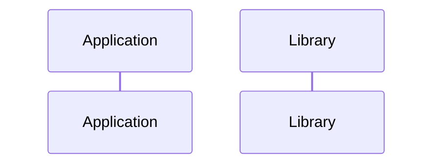

# Flow: <name>

<!-- A flow that spans crates is a section of docs/flows.md, in this shape. The same template is
in every sisaio crate repository. -->

Status: **Draft** | Accepted | Implemented · Crates: <links to the crate specs>

## Goal

What the caller or the system achieves, and what starts it.

## Sequence

## Steps and rules

The numbered steps, with which crate owns each one, whether it can run twice, and what happens
when it fails. A `sequenceDiagram` starts with `autonumber`, so a step can be named in a review
or a bug report.

## Edge cases

## Open questions
